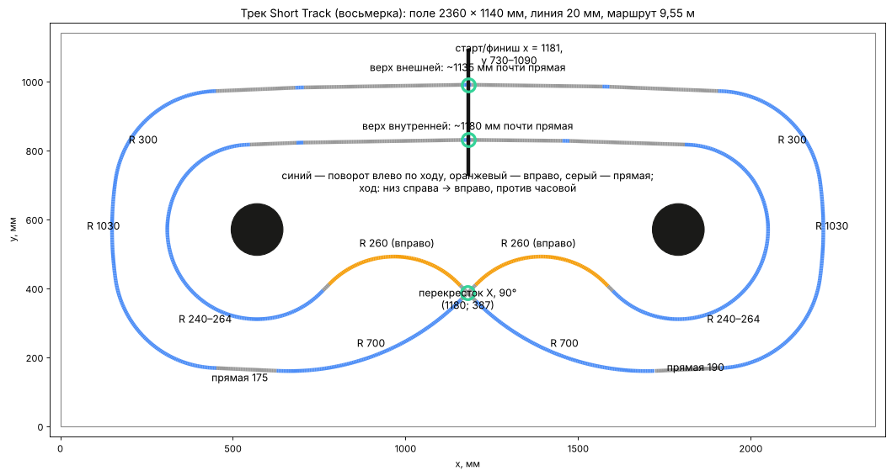

# Раскадровка анимаций — курс Arduino-Robotics-Lessons

Робот на Arduino Nano с драйвером MX1508. Шасси, колеса, моторы GA12-N20 1:50 и датчики линии — как у олимпиадного
робота (Iskra Uno); отличаются контроллер и драйвер. Трек — Short Track (восьмерка), снят с PDF.

Статус: сцены написаны (n*.py в этой папке), черновой рендер 480p. Видео и картинки курса — nano_lessons.py.

## Общее

**Код на экране — как в уроках курса.**

```cpp
float err = analogRead(LEFT_SENS) - analogRead(RIGHT_SENS);   // A0 — левый, белое выше
float control = err * kp + (err - errOld) * kd;
motors(speed + control, speed - control);
errOld = err;
delay(10);
```

- Знак — как в олимпиадном курсе: линия слева → L меньше → err < 0 → левое колесо медленнее → робот к линии.
  **В репозитории курса сейчас обратный знак** `motors(speed - control, speed + control)` (уроки 2 и 3) — привести
  к этому виду.
- **Направление моторов фиксируем.** У робота без энкодеров мотор можно поставить и подключить как угодно, поэтому
  знак управления зависит от сборки. Анимация предполагает робота, прошедшего проверку урока 1: `motors(100, 0)` —
  крутится левое колесо вперед, `motors(0, 100)` — правое вперед. Не то колесо — поменять моторы местами на выходах
  драйвера; крутится назад — поменять местами провода этого мотора. Функция `motors()` не меняется.
- `motors(0, 0)` отпускает моторы: робот катится по инерции (выбег).
- Шаг регулятора — `delay(10)` в конце `loop()`, в модели 10,3 мс. dt в коде нет: `derr = err - errOld`,
  `integral = integral + err`, шаг входит в kd и ki. `constrain()` для интеграла не нужен: на дуге интеграл сам
  останавливается на нужном значении (integral = нужный control / ki), когда err доходит до 0.
- Рабочее kp = 0,2, ПД урока 3 — kp = 0,2, kd = 1. Модель — олимпиадная, без подгонки: «почти» и kd — по алгоритму
  урока на модели.
- **Робот едет по часовой стрелке** (как в итоговой задаче): на петлях поворачивает направо, err и uI на дугах
  положительные.

**Оформление — как в олимпиадных сценах.** Видео 1920×1080, на весь слайд. Слева панель графиков (2/3 ширины),
справа робот на треке (1/3), камера едет за роботом (кроме сцены 1a). **Камера повернута так, что на старте сцены
робот едет снизу вверх**; поворот — на всю сцену. Следа робота нет. Шапка: полужирный заголовок 32 pt выезжает
слева, ниже блок формулы (Consolas 18 pt) и пояснение шага. Подписи без «ё», тире «—» в тексте, «–» в диапазонах,
десятичная запятая.

| Сигнал | Цвет |
|---|---|
| L, левый мотор | синий #4C8DF6 |
| R, правый мотор | оранжевый #F59E0B |
| err, uP | зеленый #34D399 |
| uD | розовый #E879F9 |
| **uI, integral (новый)** | **красный #F87171** — отличается от розового D; при дальтонизме ярче и теплее зеленого P |

**Время.** Сцена — целое число промежутков по **10 с** (в олимпиадном курсе — 11 с); езда ×0,3, движения «рукой» ×0,64
(`GENERAL` = 0,75). **Без пауз:** промежуток занят движением — длина прогона подбирается под промежуток,
подпись меняется во время перестановки «рукой». Робот, потерявший линию, едет дальше. «Рука» везде с одной
скоростью (150 мм/с, 120°/с во времени модели), качание в 2a — с олимпиадным периодом 1,7 с; ничего не ускорено.

**Имена файлов:** `scene-<урок><буква>-<тема>.mp4` и `.png` (картинка — кадр из того же видео, 1920×1080).

## Трек Short Track (снят с PDF)



| Что | Размер |
|---|---|
| Поле | 2360 × 1140 мм |
| Линия | 20 мм |
| Маршрут | одна замкнутая линия, 9,55 м за круг |
| Внешняя петля | углы R ≈ 300 мм; боковины — пологие дуги R ≈ 1030; низ — прямые 175–190 мм, к центру — дуги R ≈ 700 (~580 мм) |
| Внутренняя петля | R ≈ 240–264 мм, ~1 м дуги на каждую сторону; самый крутой поворот — R ≈ 240 у верхних углов |
| S-изгибы у центра | R ≈ 260 мм, ~430 мм, поворот в другую сторону |
| Верхние участки | внешний ~1,1 м, внутренний ~1,2 м — почти прямые |
| Перекрестки | центральный X (1180; 387), линии под 90°, робот проходит его дважды за круг; линия старт/финиш x = 1181, y 730–1090, пересекает обе верхние прямые под 90° — всего 4 перекрестка за круг |
| Черные круги | Ø150 мм в (570; 570) и (1790; 570), внутри петель, до линии ~175 мм — на маршрут не попадают |

Важное отличие от классической восьмерки: обе петли робот проходит в одну сторону — по часовой стрелке почти весь
круг он поворачивает направо. Налево — только S-изгибы у центра. Длинные прямые есть (верх). Отметки на маршруте
по часовой — в `nano_track.py`.

Датчики (как у олимпиадного робота, ±23,8 мм от середины, 94,7 мм впереди оси) при линии 20 мм: мертвая зона
err ≈ 0 — до ±6,5 мм смещения (при линии 30 мм было ±1,5), err > 100 — с 11,5 мм, плато ±735 — с 18 мм.

## Сцены

### scene-1a-motion — урок 1, движение

**Цель.** Знак — направление, модуль — ШИМ; при разных скоростях колес робот поворачивает; после `motors(0, 0)`
робот катится по инерции.

**Экран.** Робот без датчиков на верхней внутренней прямой, камера едет за ним (на старте робот едет вверх, линия —
эталон «прямо»). Три маневра подряд, каждый — с места остановки прошлого, без перестановок. График — ШИМ левого
и правого мотора (−255…255). Блок формулы — вызов `motors(…)`, аргументы цветом колес; подпись — одна на маневр.
Длительность маневра подобрана под промежуток.

| Промежуток | Блок формулы | Пояснение | Что видно |
|---|---|---|---|
| 1 | `motors(pwm, pwm)` | разгон и остановка | ШИМ растет 0 → 255, затем `motors(0, 0)`: ШИМ 0, робот еще катится |
| 2 | `motors(-140, 140)` | оборот на месте | колеса в разные стороны, оборот на 360° |
| 3 | `motors(150, 90)` | левое колесо быстрее — вправо | дуга вправо |

Длительность: 3 промежутка, 30 с. Камера едет за роботом: в неподвижной рамке 80 % маневры короткие (до 2 с) и не
заполняют промежуток.

### scene-2a-error — урок 2, ошибка err = L − R

**Цель.** Как датчики видят линию; знак ошибки; «мертвая зона» err = 0 при линии 20 мм.

**Экран.** Как в олимпиадной сцене 1: робот стоит на верхней внутренней прямой (смотрит вверх), его качают «рукой»
на месте ±15°. Промежуток 1: L и R (0…1023), ориентиры «белый ≈ 900», «черный ≈ 200». Промежуток 2: L и R бледнеют,
шкала ±1023, err рисуется под ними на том же качании. Пояснение: «err ≈ ±700, датчик целиком на линии».
Период качания подобран так, что оба промежутка заняты движением.

Длительность: 2 промежутка, 20 с.

### scene-2b-p — урок 2, подбор kp

**Цель.** Мало kp — робот не удерживает самый крутой поворот; дальше — едет.

**Экран.** Три прогона с одного места: верхняя внутренняя прямая, 250 мм до поворота R 240 правой внутренней петли.
Между прогонами — возврат «рукой». График err (±1023), строка ШИМ колес. Формула `control = err * kp`.

| Промежуток | Пояснение | Что видно |
|---|---|---|
| 1 | kp = 0,05 — мало, теряет линию | в повороте err на +700, робот уходит с линии и едет дальше |
| 2 | kp = 0,2 — едет | err скачет 0 ↔ +600, робот проходит поворот |
| 3 | kp = 0,3 — едет так же | почти то же, что 0,2 |

Длительность: 3 промежутка, 30 с. **По модели** робот вписывается с kp от 0,07; kp 0,2 и 0,3 почти не отличаются:
линия 20 мм уже расстояния между датчиками (47,6 мм), и робот поворачивает толчками при любом kp от 0,1. Заметно
«дерганее» становится только около kp = 1.

### scene-2c-d — урок 2, ввод D

**Цель.** Алгоритм урока: kp спускаем до «почти» (робот почти вписывается), затем поднимаем kd, пока не впишется.

**Экран.** То же место, что в 2b. Формула `control = err * kp + (err - errOld) * kd`. График uP (зеленый) и uD
(розовый).

| Промежуток | Пояснение | Что видно |
|---|---|---|
| 1 | kp = 0,06: вылет | kd = 0, робот уходит с линии |
| 2 | kd = 1, вписался | uD гасит вход в поворот, робот проходит |

Длительность: 2 промежутка, 20 с. По модели: вписывается с kp от 0,07, «почти» — 0,06, с ним — kd от 0,5. Место —
вход в поворот с прямой: на длинной дуге D малый kp не спасает (там err почти не меняется).

### scene-3a-i-offset — урок 3, смещение на дуге и И

**Цель.** На дуге постоянного радиуса ПД едет со смещением: чтобы поворачивать, нужен постоянный control,
значит — постоянная ошибка. И копит ошибку и берет поворот на себя.

**Экран.** Правая внутренняя петля по часовой (поворот направо, R 240–260), ПД из урока 2 (kp = 0,2, kd = 1).
Формула `control = uP + uD + integral * ki`. График uP (зеленый) и uI (красный), оба положительные.

| Промежуток | Пояснение | Что видно |
|---|---|---|
| 1 | ki = 0: err ≈ 210 | uP — полка ≈ +42 |
| 2 | ki = 0,004: err → 0 | uI растет до ≈ +42, uP → 0 примерно за 1 с |

Длительность: 2 промежутка, 20 с.

### scene-3b-cross — урок 3, перекресток

**Цель.** Перекресток — оба датчика на черном (ниже порога).

**Экран.** Робот едет регулятором (kp = 0,2, kd = 1) по часовой по дуге R 700 к центральному перекрестку X — там
пересекаются две кривые линии — и проезжает его. График — L и R (0…1023) с пунктиром порога 300.
Формула `L < 300 && R < 300`. Пояснения: «едем по линии» → «оба ниже порога — перекресток» → «едем дальше».

Длительность: 1 промежуток, 10 с.

Сцены «поворот по времени и квадрат» и «интеграл помнит» (`constrain()`) убраны.

### scene-4a-turn — урок 4, поворот на перекрестке (задание, делаем отдельно)

**Задача.** Робот едет по линии от старта по часовой стрелке, доезжает до главного (центрального) перекрестка X,
тормозит и поворачивает налево или направо — в ту сторону, где стоит кубик со стороной 5 см; затем едет до финиша.
От стороны поворота зависит, сколько перекрестков робот проедет до финиша.

**Робот.** Датчики линии, как в остальных сценах, и новый элемент — ультразвуковой дальномер HC-SR04 на креплении
(STL: пластина 52×22 мм, два окна Ø16 под излучатели, лапка крепления снизу) — рисуется схематично, сверху.

**Макет** (`n4a_turn.py`, три кадра без движения; робот с дальномером, кубик и луч — `nano_robot.py`):
- от старта на внутренней прямой робот приходит на X по S-изгибу; направо — через левую петлю к финишу
  на внутренней прямой (2,1 м), налево — по дуге R 700 и внешней петле к финишу на внешней прямой (2,7 м);
- кубик стоит на линии правой ветки, 15 см от X (до центра); робот на X повернулся направо — дальномер видит
  кубик на 9 см — и едет налево;
- **на подъезде по S-изгибу дальномер видит этот кубик на 17–29 см** (меньше порога 30 см): мерить расстояние
  можно только после остановки на X;
- камера неподвижна, масштаб 1,3 px/мм (в остальных сценах 1,6): в кадре подъезд, X и кубик.

Числа, кадры и график — обсуждаем отдельно.

## Параметры модели

Числа — в `nano_track.py` (датчики, трек) и в файлах сцен; физика — `model.py` и `nano_model.py` (И).

| Параметр | Сейчас | Откуда |
|---|---|---|
| Геометрия робота | как у олимпиадного: шасси Ø160, колеса ⌀43, колея 124, датчики ±23,8 / 94,7 мм, высота 10 мм | то же шасси |
| Датчики | белое 900, черное 200, σ = 2,5 мм | те же датчики, круглые числа (как ориентиры на экране) |
| Линия | 20 мм | PDF трека |
| Скорость от ШИМ | олимпиадная кривая (150 → 280, 255 → 435 мм/с) | как в олимпиадной модели, без поправки |
| Выбег, инерция, задержка | τ = 0,085 с, задержка 20 мс | олимпиадные |
| Трение в повороте | 0,7 | олимпиадное |
| Порог трогания | ШИМ 67 | олимпиадный |
| Период регулятора | 10,3 мс | `delay(10)` + чтение датчиков |

Модель олимпиадная, кроме датчиков (круглые 900 / 200) и линии 20 мм. Замеры для анимации не нужны;
энкодерные характеристики — для README.
